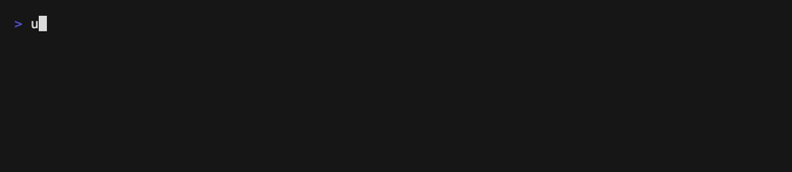
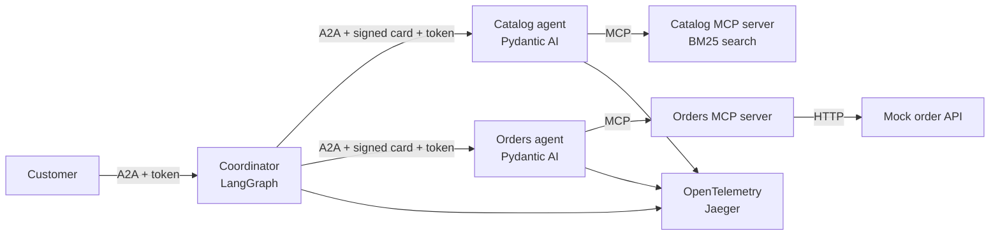

# agent-mesh

A shopping and after-sales assistant built as a small multi-agent system, for engineers who want to see the controls a production agent mesh needs in running code: typed outcomes, signed agent cards, human approval before any write, redacted traces, a kill switch and an eval gate.

[](https://github.com/adel-saoud/agent-mesh/actions/workflows/ci.yml)
[](pyproject.toml)
[](LICENSE)



## Why

Most multi-agent demos stop at "the agents talk to each other". The hard part is what happens around that: who is allowed to call whom, what a customer can read, when a write needs a human, what the traces leak, and how you know a change did not break routing.
This repo answers those questions for one concrete case: a fictional store, Kettlewick, that sells kitchen and small home appliances in France and the UAE. Catalog, customers and orders are synthetic. Answers come in English or French.

## Try it

### Requirements

- Python 3.12 or later and [uv](https://docs.astral.sh/uv/) 0.13 or later.
- For the full stack: Docker with BuildKit and Docker Compose 2.24.0 or later (the compose file marks `.env` as optional, which older versions reject). Jaeger 2.22.0 is pinned in `docker-compose.yml`; any OTLP/HTTP receiver works as `AGENT_MESH_OTLP_ENDPOINT`.
- For a real model: `GOOGLE_API_KEY`. Without it everything runs on scripted offline models.

Settings are `AGENT_MESH_*` environment variables (see `src/agent_mesh/config.py`). A misspelled one stops startup with the closest valid name instead of silently keeping a default.

### Offline, no Docker

Runs every golden suite against an in-process mesh, no API key needed:

```bash
git clone https://github.com/adel-saoud/agent-mesh.git && cd agent-mesh
```

```bash
uv run agent-mesh eval
```

### Full mesh with tracing, still offline

```bash
docker compose up --build -d
```

```bash
docker compose exec coordinator agent-mesh ask "Is the blender KW-BLD-001 loud?"
```

```bash
docker compose exec coordinator agent-mesh ask "return KW-KET-002 from ORD-1001" --conversation demo
```

```bash
docker compose exec coordinator agent-mesh ask --conversation demo --confirm yes
```

Traces are at http://localhost:16686. Kill an agent for 60 seconds and the coordinator answers `UNAVAILABLE`:

```bash
docker compose exec coordinator agent-mesh kill orders-agent --ttl 60
```

Demo customers: `cus-fr-001` and `cus-fr-002` (France, 30-day returns), `cus-ae-001` (UAE, 15-day returns, humidifiers excluded). To use Gemini, copy `.env.example` to `.env` and set `AGENT_MESH_MODEL=google:gemini-2.5-flash` and `GOOGLE_API_KEY`.

## How it works



1. The coordinator (a LangGraph graph) screens the question for prompt injection, routes it, and calls one or both specialists over [A2A](https://a2a-protocol.org) 1.0 with the official `a2a-sdk`.
2. Each call carries a short-lived ES256 token with audience and replay checks, and the coordinator verifies the specialist's signed agent card first. The customer id comes from the token, never from the model.
3. Specialists (Pydantic AI agents) reach their data only through their own MCP server, run as a stdio subprocess, so no tool server is reachable from the network.
4. Every reply is one typed kind: `ANSWER`, `CLARIFY`, `DOC_GAP`, `NOT_FOUND`, `DECLINE` or `UNAVAILABLE`. Callers branch on the kind instead of parsing prose.
5. A return is only proposed. The graph pauses, and the write runs after the customer confirms, with a token bound to that exact action.
6. One OpenTelemetry trace covers every hop, with GenAI span attributes and PII redacted before export.

Services, request flow, security controls and failure modes: [docs/architecture.md](docs/architecture.md).

## Results

Every number here comes from [results/manifest.json](results/manifest.json), regenerated by:

```bash
uv run python scripts/reproduce.py
```

Last run: 2026-10-24, Python 3.14.4, Apple M4 Pro, scripted offline models.

| Golden suite | Passed | Cases |
|---|---|---|
| [catalog-agent](evals/golden/catalog-agent.json) | 7 | 7 |
| [coordinator](evals/golden/coordinator.json) | 8 | 8 |
| [orders-agent](evals/golden/orders-agent.json) | 10 | 10 |

The cases check outcome kind, reply language, required citations, decline reason and whether a write was proposed. With scripted models they prove the wiring and the guards, not answer quality. A live-model score is not published yet: `--live` runs the same suites on the model set in `AGENT_MESH_MODEL`, with that provider's key.

## Design decisions

- [A typed outcome contract with six kinds](docs/adr/0004-typed-outcome-contract.md): callers and evals branch on a kind, never on prose.
- [Human confirmation before any write, with an action-bound token](docs/adr/0005-human-confirmation-before-writes.md): the model proposes, code files after a "yes".
- [MCP tool servers as stdio subprocesses, customer id in `_meta`](docs/adr/0003-mcp-servers-over-stdio-with-customer-id-in-meta.md): no tool server on the network, and the model never chooses whose data it reads.

All decision records: [docs/adr/README.md](docs/adr/README.md).

## Limits

- The CI gate runs scripted models. It catches routing, contract and security regressions, not a drop in answer quality. The live-model run is manual and report-only.
- Injection screening is rule-based (English and French). A paraphrased attack can get through.
- Trace redaction is regex with checksums: emails, French and UAE phone numbers, card numbers (Luhn) and IBANs. Names and street addresses are not redacted, which is why message content is off by default.
- In compose all services share one key volume. Production would give each service only its own private keys and publish public keys over JWKS.
- Catalog search is BM25 over 60 synthetic products. No semantic search.
- Tried serving the specialists with `fasta2a`: its task timestamps have no timezone and the `a2a-sdk` client rejects them, so the specialists use `a2a-sdk` directly.
- Tried `a2a-sdk`'s built-in tracing: most of its spans described its internal event queue, so it is turned off in the image.
- No checkout yet. Checkout with human approval (AP2 mandates) is planned for v1.1.

## Part of a system

- [llm-regression-detector](https://github.com/adel-saoud/llm-regression-detector): `agent-mesh eval --export-dir DIR` writes a schema v2 dataset and the mesh's answers per suite, which `lrd score` judges without re-running the mesh.
- [trace-to-golden](https://github.com/adel-saoud/trace-to-golden): reads the mesh's OpenTelemetry GenAI spans and turns them into new golden cases. What it may rely on is the versioned [trace contract](docs/architecture.md#trace-contract): span attributes, redaction placeholders, opt-in message content and `traceparent` propagation.
- [llm-gateway](https://github.com/adel-saoud/llm-gateway): not wired yet. Model calls go straight to the provider today.

## Development

```bash
uv sync
```

```bash
uv run pre-commit install
```

```bash
uv run pre-commit run --all-files
```

```bash
uv run pytest
```

Ruff, pyright (strict on `src`, `tests` and `scripts`) and gitleaks run in pre-commit, and commit messages follow Conventional Commits (checked by commitizen). Releases: `uv run cz bump` updates the version and the tag; [CHANGELOG.md](CHANGELOG.md) is written by hand.

## License

[MIT](LICENSE)
