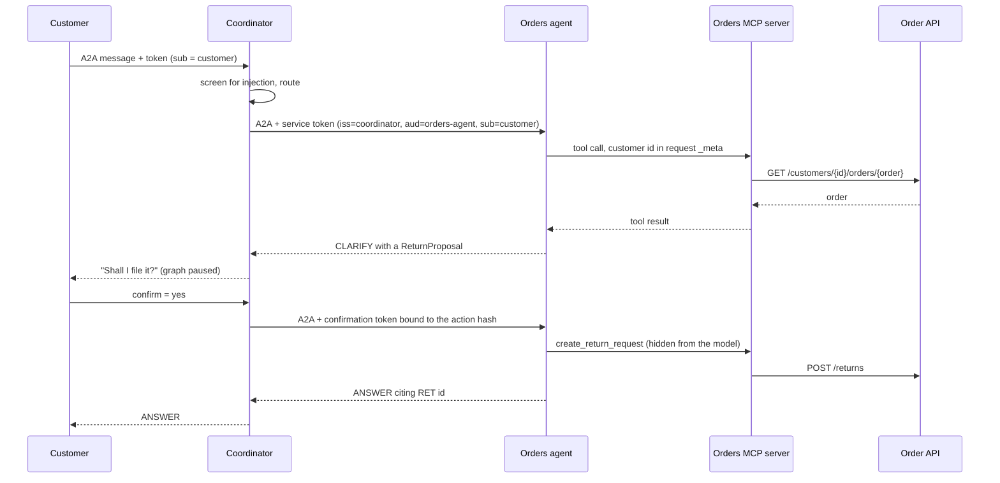

# Architecture

## Services

| Service | Framework | Role | Port (compose) |
|---|---|---|---|
| `coordinator` | LangGraph | Screens input, routes, calls specialists in parallel, merges outcomes, pauses for confirmation | 8000, published on localhost |
| `catalog-agent` | Pydantic AI | Product questions over the synthetic catalog | 8001, internal |
| `orders-agent` | Pydantic AI | Order status, return eligibility, return requests | 8002, internal |
| `orders-api` | Starlette | Mock order system, the source of truth for orders and returns | 8100, internal |
| `jaeger` | Jaeger v2 | Trace store and UI | 16686, published on localhost |

The two MCP servers (`catalog_server`, `orders_server`) run as stdio subprocesses of their specialist, so a tool server is never reachable from the network.

## Request flow



## Outcome contract

`src/agent_mesh/contracts.py` defines one discriminated union. Every agent returns exactly one kind, with the user-facing message in the reply language.

| Kind | Meaning | Example |
|---|---|---|
| `ANSWER` | Grounded answer with at least one citation | Price of a kettle, order status |
| `CLARIFY` | A question back to the user, optionally with a pending write | "Which item?", "Shall I file the return?" |
| `DOC_GAP` | The subject exists but the fact is not documented | Wattage missing for a Basics kettle |
| `NOT_FOUND` | No such product, or no such order on this account | Another customer's order |
| `DECLINE` | Refused, with a reason (`out_of_scope`, `prompt_injection`, `policy`) | "Ignore previous instructions..." |
| `UNAVAILABLE` | An agent is killed or failed | Kill switch on `orders-agent` |

Citations the model invents are dropped: an `ANSWER` whose citations were not retrieved in the same run becomes `DOC_GAP`.

When several specialists answer, a pending `CLARIFY` wins, `ANSWER`s are joined, and otherwise the most useful kind wins (`CLARIFY` > `DOC_GAP` > `NOT_FOUND` > `DECLINE` > `UNAVAILABLE`).

## Security

| Control | Where | Notes |
|---|---|---|
| Signed agent cards | `security/cards.py` | JWS over the card; the caller checks the signer is the agent it meant to reach |
| Per-request bearer tokens | `security/tokens.py`, `security/auth.py` | ES256, `aud` = callee URL, `exp` 60 s, `jti` replay cache, issuer allow-list per service. Verified by Starlette's `AuthenticationMiddleware`; attached by a2a-sdk's `AuthInterceptor` for the scheme the card declares |
| Customer identity | `a2a_server.py`, `specialists/agents.py` | Taken from the token `sub`, passed to tools in MCP `_meta`; the model never sees or sets it |
| Write approval | `coordinator/graph.py`, `mcp_servers/orders_server.py` | LangGraph `interrupt`; the write tool is hidden from the model and needs a confirmation token bound to the action hash |
| Injection screening | `security/screening.py` | Rules on user input (EN and FR) and on retrieved reviews, which are withheld when flagged |
| Cross-customer reads | `orders_api.py` | Another customer's order returns `NOT_FOUND`, not `DECLINE`, so the answer does not confirm the order exists |
| PII on traces | `observability/tracing.py` | Emails, phone numbers (FR, UAE), card numbers (Luhn) and IBANs (mod 97) are replaced by `<ENTITY_TYPE>` before export |

### Keys

`agent-mesh keys init` writes one card key and one token key per principal, plus a JWKS file. In compose, all services share one key volume. That is a demo shortcut: in production each service holds only its own private keys, from a secret manager or KMS, and fetches the others' public keys from a JWKS endpoint.

## Kill switch

`agent-mesh kill <agent> [--ttl SECONDS]` writes a shared JSON file. The coordinator checks it before calling, and the specialist checks it again on receipt, so a killed agent stops even if a caller has a stale view. A corrupt file counts as "everything killed": the switch fails closed.

## Tracing

Spans follow the OpenTelemetry GenAI semantic conventions. The coordinator sets its own GenAI attributes; the specialists' model and tool spans come from Pydantic AI's instrumentation. W3C `traceparent` travels over every A2A call, so one question is one trace. Health checks are not traced, and a2a-sdk's own instrumentation of its internal event queue is turned off (`OTEL_INSTRUMENTATION_A2A_SDK_ENABLED=false` in the image), which cut a question's trace from about 175 spans to 22 (measured on the compose stack on 2026-10-20). What other tools may rely on is the trace contract below.

## Trace contract

Version **1.0.0**. Consumers, first of all [trace-to-golden](https://github.com/adel-saoud/trace-to-golden), pin this version. Every exported span carries it as the resource attribute `agent_mesh.trace_contract.version`, set from `TRACE_CONTRACT_VERSION` in `observability/tracing.py`; a test fails if this page and the code disagree.

Versioning: removing or renaming anything below is a major bump, adding an attribute or a placeholder is a minor bump. Every bump gets a CHANGELOG entry here and in the consuming repo.

### Transport and trace boundaries

- OTLP over HTTP (protobuf) to `AGENT_MESH_OTLP_ENDPOINT`. No endpoint, no export.
- Resource attributes: `service.name` (`coordinator`, `catalog-agent`, `orders-agent`, `orders-api`) and `agent_mesh.trace_contract.version`.
- One trace per question: the user client and the coordinator inject W3C `traceparent` (and `tracestate`) on every A2A call, and every service continues the caller's trace.
- Not covered: the stdio hop from a specialist to its MCP server carries no trace context, so `orders-api` server spans start their own trace.

### Coordinator span

One span per question or confirmation, named `invoke_agent coordinator`.

| Attribute | Value |
|---|---|
| `gen_ai.operation.name` | `invoke_agent` |
| `gen_ai.agent.name` | `coordinator` |
| `gen_ai.provider.name` | Model name before the first `:` (`google`), or `offline` for the scripted models |
| `gen_ai.request.model` | `AGENT_MESH_MODEL` as configured, for example `google:gemini-2.5-flash` |
| `gen_ai.conversation.id` | The conversation id the client sent |
| `agent_mesh.outcome` | `ANSWER`, `CLARIFY`, `DOC_GAP`, `NOT_FOUND`, `DECLINE` or `UNAVAILABLE` |
| `error.type` | `unavailable`, only when the outcome is `UNAVAILABLE`; the span status is then `ERROR` |
| `gen_ai.input.messages`, `gen_ai.output.messages` | Opt-in, see below |

Event `agent_mesh.injection_screen` with attribute `rules` (list of rule names) when screening flags the question. The flagged text is never recorded.

### Other spans

- Server spans are named `<METHOD> <route template>`, for example `GET /customers/{customer_id}/orders`, never the raw path.
- Specialist model and tool spans (`gen_ai.operation.name` = `chat`, ...) come from Pydantic AI. Their other attribute names follow the installed Pydantic AI version and are not part of this contract.

### Message content (opt-in)

Off by default. With `AGENT_MESH_CAPTURE_MESSAGE_CONTENT=true`, the coordinator span records the question and the answer as JSON strings in the GenAI message shape:

```json
[{"role": "user", "parts": [{"type": "text", "content": "Where is ORD-1001? Reach me at <EMAIL_ADDRESS>"}]}]
```

Pydantic AI then also records prompts and tool arguments on the specialist spans.

### Redaction

Before export, every string attribute and every event attribute of every span is redacted with these placeholders:

| Placeholder | Matches |
|---|---|
| `<EMAIL_ADDRESS>` | Email addresses |
| `<PHONE_NUMBER>` | French (`+33`, `0033`, national `0X`) and UAE (`+971`, `00971`) numbers |
| `<CREDIT_CARD>` | 13 to 19 digit numbers that pass the Luhn check |
| `<IBAN_CODE>` | IBANs that pass the mod 97 check |

The customer id is never a span attribute, an event attribute or part of a span name.

## Evals

Golden cases live in `evals/golden/`, one file per agent. `agent-mesh eval` runs them against an in-process mesh and checks the outcome kind, language, required citations, decline reason and whether a write was proposed. Any failure fails CI.

`--export-dir` also writes, per suite, a dataset in llm-regression-detector schema v2 (`expected_category` = the final outcome kind, `rubric` for answer quality, `source` naming the market, never a customer id) and a predictions file with what the mesh answered. `lrd score --dataset <suite>.dataset.json --predictions <suite>.predictions.jsonl` judges that pair without re-running anything. The export lives in one module, `evals/export.py`. CI runs `lrd score` once llm-regression-detector can be installed from a pinned release; until then the deterministic checks are the gate.

## Failure modes

| Failure | What the customer gets | Where it is handled |
|---|---|---|
| A specialist is killed | `UNAVAILABLE` for that part of the question | `control/kill_switch.py`, `coordinator/graph.py` |
| A specialist call fails, its card does not verify, or its reply does not parse | `UNAVAILABLE` (`UPSTREAM_ERROR` or `INVALID_RESPONSE`) | `coordinator/clients.py` |
| Kill switch file is corrupt | Every agent counts as killed (fails closed) | `control/kill_switch.py` |
| The model cites a source it did not retrieve | The citation is dropped; an `ANSWER` left with no citation becomes `DOC_GAP` | `specialists/base.py` |
| Prompt injection in the question or in a retrieved review | `DECLINE` (`prompt_injection`), or the review is withheld | `security/screening.py` |
| Order belongs to another customer | `NOT_FOUND` | `orders_api.py` |
| Confirmation does not match the proposed action | No write; the confirmation token is bound to the action hash | `mcp_servers/orders_server.py` |

## When to split an agent out

The coordinator can call a specialist in process or over A2A (`coordinator/clients.py`). Run a specialist as its own service when at least one of these holds:

- it has its own release cadence or owning team;
- it needs a different trust zone, for example access to order data that the catalog agent must not have;
- it scales differently from the coordinator.

Otherwise keep it in process: each network hop adds latency, a failure mode and a token to manage.

## Protocol choices

| Need | Choice | Why |
|---|---|---|
| Agent to agent | A2A 1.0 via `a2a-sdk` | Open spec under the Linux Foundation, framework neutral |
| Agent to tool | MCP | Standard tool interface; Pydantic AI ships an MCP client |
| Checkout (v1.1) | AP2 mandates over A2A | Cart and payment approval as signed, verifiable objects |
